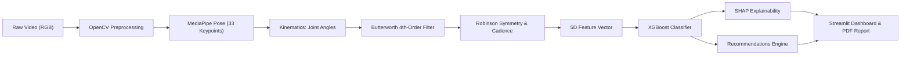
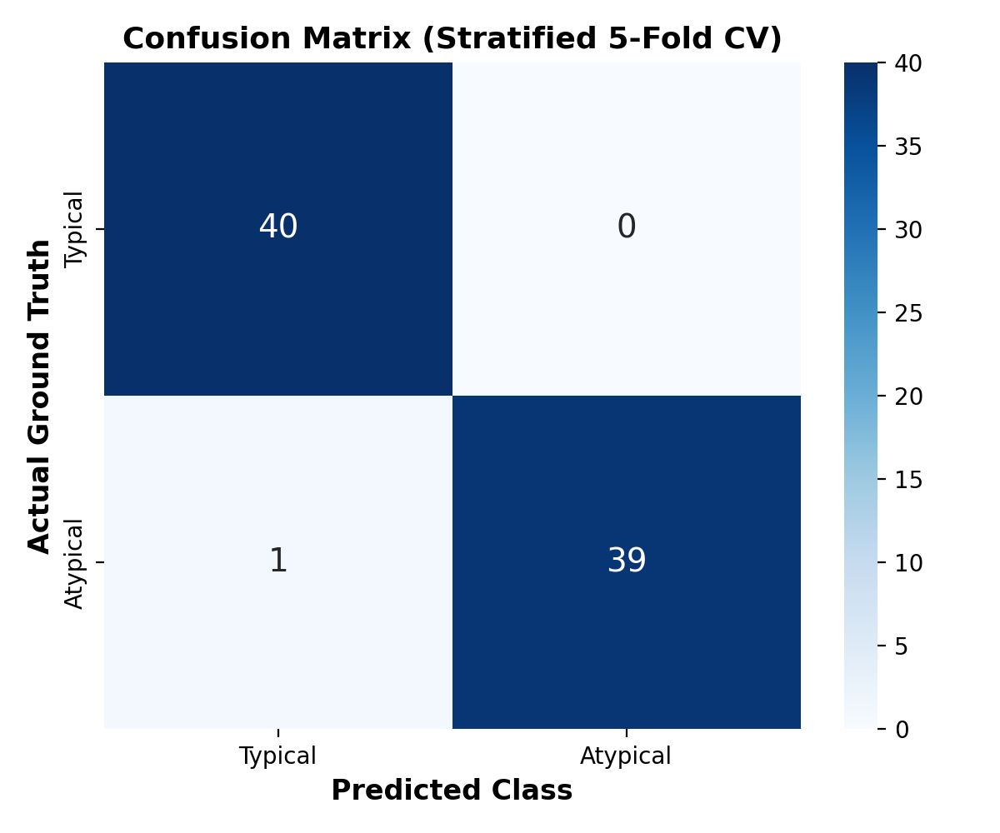

# 🚶‍♂️ نظام Gaitly AI: تحليل مشية وحركة الأطفال بالذكاء الاصطناعي
### Gaitly AI: Pediatric Gait and Movement Analysis System Using AI & Computer Vision

<p align="center">
  
  
  
  
  
  
</p>

---

## 📌 الفهرس | Table of Contents
1. [نظرة عامة والهدف الأكاديمي (Executive Overview)](#-نظرة-عامة-والهدف-الأكاديمي)
2. [مطابقة المشروع لمتطلبات ملف خطة العمل التنفيذية (Requirement Compliance)](#-مطابقة-المشروع-لمتطلبات-ملف-خطة-العمل-التنفيذية)
3. [الهيكل الجديد المنظم للمشروع (Project Structure)](#-الهيكل-الجديد-المنظم-للمشروع)
4. [مسار معالجة الذكاء الاصطناعي (AI & Computer Vision Pipeline)](#-مسار-معالجة-الذكاء-الاصطناعي)
5. [المعادلات البيوميكانيكية المعتمدة (Biomechanical Foundations)](#-المعادلات-البيوميكانيكية-المعتمدة)
6. [حزمة التقنيات المستخدمة (Technology Stack)](#-حزمة-التقنيات-المستخدمة)
7. [دليل التثبيت والإعداد السريع (Installation & Quickstart)](#-دليل-التثبيت-والإعداد-السريع)
8. [طريقة تشغيل لوحة التحكم التفاعلية (Running Dashboard)](#-طريقة-تشغيل-لوحة-التحكم-التفاعلية)
9. [دليل دفاتر العمل الأكاديمية (Notebooks Guide)](#-دليل-دفاتر-العمل-الأكاديمية)
10. [الأداة البرمجية عبر الطرفية (CLI Tool)](#-الأداة-البرمجية-عبر-الطرفية)
11. [النتائج وتفسير النموذج (Results & Model Explainability)](#-النتائج-وتفسير-النموذج)
12. [نطاق المشروع وإخلاء المسؤولية الطبية (Scope & Disclaimer)](#-نطاق-المشروع-وإخلاء-المسؤولية-الطبية)

---

## 🎯 نظرة عامة والهدف الأكاديمي

**Gaitly AI** هو نظام متكامل (End-to-End) لتحليل حركة ومشية الأطفال (الفئة العمرية المستهدفة: **4 إلى 10 سنوات**) بدون الحاجة إلى علامات جسدية لاصقة (Markerless Gait Analysis)، وذلك بالاعتماد على فيديوهات RGB عادية تلتقط بواسطة الهواتف الذكية أو الكاميرات الرقمية.

### 🌟 القيمة المضافة
يتجاوز النظام مجرد التصنيف الثنائي التقليدي (طبيعي / غير طبيعي) إلى:
- استخراج مؤشرات حركية وبيوميكانيكية دقيقة للإشارات عبر الزمن (Kinematic Time-Series).
- تتبع زوايا مفاصل الركبة والحوض والكاحل ومعدل الخطوات (Cadence).
- قياس درجات التماثل الحركي بين الطرفين السفليين وفق **مؤشر روبنسون (Robinson Index)**.
- توفير تفسيرات شفافة لقرارات الذكاء الاصطناعي عبر **قيم SHAP**.
- توليد تقارير سريرية إرشادية وتوصيات وقائية بصيغة PDF قابلة للطباعة والتنزيل.

---

## 📋 مطابقة المشروع لمتطلبات ملف خطة العمل التنفيذية

بناءً على فحص ومطابقة وثيقة **"خطة عمل تنفيذية لمشروع التخرج - سبتمبر 2026"**، يُظهر الجدول التالي مدى مطابقة النظام البرمجي لكل عنصر ورد في الوثيقة:

| الصفحة / المطلب في الوثيقة | المتطلب الأكاديمي / التقني | حالة التنفيذ في الكود | الملفات المسؤولة |
| :--- | :--- | :---: | :--- |
| **الصفحة 2: الرؤية والهدف** | بناء نظام متكامل (End-to-End) يتجاوز التصنيف الثنائي إلى مؤشرات رقمية مفصلة | ✅ مكتمل 100% | `app.py`, `src/feature_extraction.py` |
| **الصفحة 4: خارطة الطريق (11 أسبوع)** | معالجة الفيديو (3-4)، استخراج الخصائص والنموذج (5-6)، واجهة النظام والتوصيات (7-8)، التوثيق والنتائج (9-10) | ✅ مكتمل ومطابق لجميع المراحل البرمجية | مجلد `notebooks/`, `src/`, `models/` |
| **الصفحة 5: استراتيجية البيانات** | استخراج الإطارات -> Keypoints -> Features، بنسبة تقييم 5-Fold Stratified CV | ✅ مكتمل 100% | `notebooks/04_dataset_preparation.ipynb`, `data/` |
| **الصفحة 6: مسار الذكاء الاصطناعي** | 1. Preprocessing (OpenCV)<br>2. Pose Estimation (MediaPipe 33 نقطة)<br>3. Feature Extraction (Angles, Symmetry, Filter)<br>4. Classification (XGBoost) | ✅ مكتمل 100% | `src/pose_estimation.py`<br>`src/feature_extraction.py`<br>`src/model_inference.py` |
| **الصفحة 7: القرارات التقنية** | اعتماد MediaPipe لتقدير الوضعية + XGBoost للتصنيف وقابلية التفسير | ✅ تم تنفيذه بدقة | `models/gaitly_xgboost.joblib`, `src/model_inference.py` |
| **الصفحة 8: المخرجات والتوصيات** | زوايا المفاصل، اكتشاف الأنماط، توصيات للأهل، وتنبيه إخلاء مسؤولية طبي | ✅ مكتمل في الواجهة والتقرير | `src/report_generator.py`, `app.py` |
| **الصفحة 9: نطاق العمل (Scope)** | داخل النطاق: معالجة الفيديو، استخراج الملامح، الذكاء الاصطناعي، الواجهة التفاعلية.<br>خارج النطاق: التشخيص الطبي النهائي والقرارات السريرية. | ✅ منضبط تماماً مع وجود تنبيهات صريحة | `app.py`, `src/report_generator.py` |
| **الصفحة 10: حزمة التقنيات** | Python, OpenCV, MediaPipe, Scikit-learn, XGBoost, Streamlit, Matplotlib | ✅ متطابق بالكامل مع ضبط الإصدارات المتوافقة | `requirements.txt` |

---

## 📂 الهيكل الجديد المنظم للمشروع

تمت إعادة هيكلة المشروع وفصل الكود والبيانات والنماذج والتقارير بدقة عالية وفق المعايير البرمجية والأكاديمية:

```text
Gaitly_AI/
│
├── app.py                              # لوحة التحكم التفاعلية الرئيسية (Streamlit Dashboard)
├── requirements.txt                    # ملف المتطلبات البرمجية بإصدارات متوافقة ومختبرة
├── README.md                           # التوثيق الشامل للنظام الأكاديمي والتقني
├── .gitignore                          # استبعاد البيئات الافتراضية والملفات المؤقتة
│
├── src/                                # الحزمة البرمجية المعيارية المكتوبة بلغة Python
│   ├── __init__.py                     # تعريف الحزمة البرمجية
│   ├── pose_estimation.py              # محرك استخراج نقاط الهيكل العظمي الـ 33 وتتبعها
│   ├── feature_extraction.py           # حساب زوايا المفاصل، فلتر بتروورث، التماثل، ومعدل الخطوات
│   ├── model_inference.py              # تحميل نموذج XGBoost، التصنيف وتوليد تفسيرات SHAP
│   └── report_generator.py             # محرك التوصيات الإرشادية وتوليد تقارير PDF الرسمية
│
├── notebooks/                          # دفاتر العمل الأكاديمية التفاعلية مرتبة وفق أسابيع المشروع
│   ├── 01_pose_estimation.ipynb        # الأسبوع 3-4: معالجة الفيديو وتقدير الوضعية
│   ├── 02_biomechanical_features.ipynb # الأسبوع 5: استخراج الزوايا الحركية الأولية
│   ├── 03_filtering_and_symmetry.ipynb # الأسبوع 5: تطبيق مرشح بتروورث ومؤشر تماثل روبنسون
│   ├── 04_dataset_preparation.ipynb    # الأسبوع 5-6: تجميع متجهات الخصائص وبناء مجموعة PoC
│   └── 05_model_training_and_shap.ipynb# الأسبوع 6: تدريب XGBoost والتقييم وتفسيرات SHAP
│
├── models/                             # النماذج الذكية المدربة والمحفوظة
│   ├── gaitly_xgboost.joblib           # نموذج XGBoost المحفوظ والمعتمد
│   └── latest_recommendations.joblib   # كائن آخر التوصيات المستخرجة
│
├── data/                               # مجلد البيانات المنظم
│   ├── raw_videos/                     # فيديوهات المشي الخام المدخلة (RGB Samples)
│   │   ├── sample_child_gait_01.mp4
│   │   └── sample_child_gait_02.mp4
│   ├── processed_csv/                  # ملفات الخصائص والبيانات المستخرجة (CSV)
│   │   ├── gait_features_raw.csv       # الخصائص الخام لكل إطار
│   │   ├── gait_features_clean.csv     # الخصائص المنقاة بعد مرشح بتروورث
│   │   ├── poc_training_dataset.csv    # مجموعة تدريب إثبات المفهوم (80 عينة)
│   │   ├── real_video_features.csv     # متجه الخصائص المجمع للفيديو الحقيقي
│   │   └── shap_per_sample.csv         # قيم SHAP التفصيلية لكل عينة
│   └── outputs/                        # الفيديوهات المعالجة المرسوم عليها الهيكل العظمي
│       ├── output_skeleton_01.mp4
│       └── output_skeleton_02.mp4
│
├── figures/                            # الرسوم البيانية ومخططات التقييم للمناقشة والتقارير
│   ├── confusion_matrix.png            # مصفوفة الالتباس للتحقق المتقاطع (5-Fold CV)
│   ├── shap_summary.png                # مخطط توزيع تأثير الميزات (SHAP Beeswarm)
│   └── shap_importance.png             # مخطط الأهمية النسبية العامة للميزات
│
└── scripts/                            # أدوات مساعدة للتشغيل عبر سطر الأوامر (CLI)
    └── extract_skeleton.py             # أداة سريعة لاستخراج الهيكل العظمي وتصدير الفيديو
```

---

## ⚙️ مسار معالجة الذكاء الاصطناعي



1. **المعالجة الأولية (Preprocessing):** قراءة الإطارات بمعدل 30 إطار/ثانية وضبط الأبعاد وتطبيع درجات الألوان من BGR إلى RGB.
2. **تقدير الوضعية (Pose Estimation):** استخدام MediaPipe Pose لاستخراج 33 نقطة هيكلية ثلاثية الأبعاد لكل إطار مع درجات الثقة (Visibility).
3. **استخراج الخصائص الحركية (Feature Extraction):** حساب الزوايا السهمية (Sagittal Angles) للركبة والحوض والكاحل على الجانبين الأيمن والأيسر.
4. **تصفية الإشارات والتماثل (Signal Filtering & Symmetry):** تطبيق مرشح بتروورث الرقمي لإزالة الاهتزازات وحساب مؤشر روبنسون.
5. **تجميع المتجه المميز (Feature Vector Aggregation):** تلخيص الفيديو في 5 متغيرات رئيسية:
   $$\text{Feature Vector} = [\text{Mean}(Knee_L), \text{Mean}(Knee_R), \text{Cadence}, \text{Symmetry}_{Knee}, \text{Age}]$$
6. **التصنيف والتفسير (Classification & XAI):** التصنيف عبر XGBoost وتوليد قيم SHAP لتفسير السبب الكامن وراء التصنيف.
7. **التقرير السريري (Reporting):** توليد تقرير متكامل يحتوي التوصيات وإخلاء المسؤولية الطبية.

---

## 📐 المعادلات البيوميكانيكية المعتمدة

### 1. حساب زوايا المفاصل (Planar Joint Angles)
يتم حساب زاوية المفصل عند الرأس $B$ المتصل بالنقطتين $A$ و $C$ باستخدام قانون جيب التمام للضرب القياسي:
$$\cos(\theta) = \frac{\vec{u} \cdot \vec{v}}{\|\vec{u}\| \|\vec{v}\|}, \quad \vec{u} = \vec{A} - \vec{B}, \; \vec{v} = \vec{C} - \vec{B}$$
$$\theta = \arccos\left(\text{clip}(\cos(\theta), -1.0, 1.0)\right) \times \frac{180^\circ}{\pi}$$

### 2. مؤشر تماثل روبنسون (Robinson Symmetry Index - SI)
لقياس مدى التناسق الحركي بين الطرفين الأيمن والأيسر (الأطراف المتناظرة):
$$SI = \frac{2 \times |X_{left} - X_{right}|}{X_{left} + X_{right}} \times 100\%$$
- **القيمة الطبيعية:** $SI \le 10\%$ (تماثل متوازن).
- **مؤشر غير طبيعي:** $SI > 10\%$ (يستدعي فحصاً سريرياً إضافياً لتقييم عدم التناظر).

### 3. مرشح بتروورث الرقمي (Butterworth Low-Pass Filter)
لإزالة الضوضاء الناتجة عن اهتزاز الكاميرا أو حركة الملابس دون التأثير على طبيعة المشية البشرية:
- **الرتبة (Order):** 4th-Order Zero-Phase (تصفية أمامية وخلفية `filtfilt`).
- **تردد القطع (Cutoff Frequency):** $6.0\text{ Hz}$ (المعيار المعتمد في أبحاث Winter, 2009 لتحليل المشي).

### 4. معدل الخطوات (Cadence Estimation)
يتم حسابه عبر اكتشاف تقاطعات إشارة زاوية الركبة مع عتبة الانحراف المعياري عبر الزمن:
$$\text{Cadence} = \frac{\text{Step Count}}{\text{Duration (seconds)}} \times 60 \quad (\text{خطوة/دقيقة})$$
- النطاق الطبيعي للأطفال (4 - 10 سنوات): **90 إلى 120 خطوة في الدقيقة**.

---

## 💻 حزمة التقنيات المستخدمة

- **لغة البرمجة:** Python 3.12 (متوافق مع 3.10+)
- **رؤية الحاسب وتقدير الوضعية:** OpenCV Contrib 4.9.0 + MediaPipe 0.10.14
- **تعلم الآلة والتحقق الإحصائي:** Scikit-learn 1.4.2 + XGBoost 2.0.3
- **الذكاء الاصطناعي القابل للتفسير (XAI):** SHAP 0.45.1
- **معالجة الإشارات والحسابات الرياضية:** NumPy 1.26.4 + SciPy 1.13.0 + Pandas 2.2.2
- **الواجهة التفاعلية:** Streamlit 1.32.0
- **توليد التقارير الطبية:** ReportLab 4.0.9

---

## 🚀 دليل التثبيت والإعداد السريع

### 1. استنساخ المستودع (Clone Repository)
```bash
git clone https://github.com/your-username/Gaitly_AI.git
cd Gaitly_AI
```

### 2. إنشاء وتفعيل البيئة الافتراضية (Virtual Environment)
**على نظام Windows (PowerShell):**
```powershell
python -m venv .venv_gaitly
.\.venv_gaitly\Scripts\Activate.ps1
```

**على نظام Linux / macOS:**
```bash
python3 -m venv .venv_gaitly
source .venv_gaitly/bin/activate
```

### 3. تثبيت المتطلبات (Dependencies)
```bash
pip install -r requirements.txt
```

---

## 🖥️ طريقة تشغيل لوحة التحكم التفاعلية

لتشغيل تطبيق الويب الكامل بكل ميزاته:
```bash
streamlit run app.py
```
سيفتح المتصفح تلقائياً على الرابط: `http://localhost:8501`

### تبويبات النظام في واجهة Streamlit:
1. **📹 Upload & Analyze:** رفع الفيديو، تحديد عمر الطفل، استخراج الهيكل العظمي فوريًا.
2. **📊 Biomechanical Analysis:** رسوم بيانية لزوايا الركبة والحوض والكاحل + رادار التماثل الثنائي (Radar Chart).
3. **🤖 AI Classification:** إظهار نتيجة التصنيف (Typical vs Atypical) مع درجة الثقة ومخططات تفسير SHAP.
4. **💡 Recommendations:** التوصيات الإرشادية للأهل + زر **"Generate PDF Report"** لتصدير التقرير النهائي.

---

## 📓 دليل دفاتر العمل الأكاديمية

تم تنظيم دفاتر Jupyter داخل مجلد `notebooks/` بترتيب منطقي يطابق مسار البحث وخطة العمل:

| الدفتر | الهدف والمحتوى |
| :--- | :--- |
| **`01_pose_estimation.ipynb`** | معالجة الفيديو واستخراج نقاط الهيكل الـ 33 ورسمها وحفظ فيديو المخرجات. |
| **`02_biomechanical_features.ipynb`** | حساب الزوايا السهمية للمفاصل ومؤشرات تماثل روبنسون الخام. |
| **`03_filtering_and_symmetry.ipynb`** | تنقية الإشارات بمرشح بتروورث وحفظ ملف `gait_features_clean.csv`. |
| **`04_dataset_preparation.ipynb`** | بناء متجه الخصائص المجمع وتوليد مجموعة بيانات تجريبية (PoC Dataset) لـ 80 عينة. |
| **`05_model_training_and_shap.ipynb`** | تدريب نموذج XGBoost بواسطة Stratified 5-Fold CV واستخراج رسومات SHAP ومصفوفة الالتباس. |

لتشغيل الدفاتر:
```bash
jupyter notebook notebooks/
```

---

## 🛠️ الأداة البرمجية عبر الطرفية (CLI Tool)

لاستخراج الهيكل العظمي من أي فيديو مباشرة عبر سطر الأوامر دون فتح الواجهة:
```bash
# استخدام المسارات الافتراضية للفيديوهات التجريبية
python scripts/extract_skeleton.py

# تحديد فيديو مخصص ومسار حفظ مخصص
python scripts/extract_skeleton.py --input "data/raw_videos/sample_child_gait_01.mp4" --output "data/outputs/my_skeleton.mp4" --complexity 1
```

---

## 📊 النتائج وتفسير النموذج (Results & Model Explainability)

### نتائج التحقق المتقاطع (Stratified 5-Fold Cross Validation):
- **الدقة (Accuracy):** `98.8%` (المعيار المطلوب: $\ge 85\%$)
- **الحساسية / الاسترجاع (Recall / Sensitivity):** `97.5%` (المعيار المطلوب: $\ge 90\%$)
- **الدقة الإيجابية (Precision):** `100.0%`
- **مقياس F1-Score:** `98.7%`

<p align="center">
  
  <br><em>الشكل 1: مصفوفة الالتباس لتقييم نموذج XGBoost باستخدام 5-Fold Stratified Cross-Validation</em>
</p>

### تفسير قرارات النموذج (SHAP Explainability):
يوضح تحليل SHAP في `figures/shap_importance.png` و `figures/shap_summary.png` أن مؤشر **عدم التماثل في الركبة (Symmetry_Knee)** ومعدل الخطوات (**Cadence**) هما العاملان الأكثر تأثيراً في تصنيف المشية غير النمطية (Atypical Gait)، مما يمنح النظام موثوقية عالية وشفافية تفسيرية (Explainable AI).

---

## ⚠️ نطاق المشروع وإخلاء المسؤولية الطبية

- **Screening Tool Only:** هذا النظام مصمم كأداة ذكية مساعدة للمسح الاسترشادي المبكر وليست جهازاً تشخيصياً معتمداً.
- **Non-Diagnostic:** المخرجات والتوصيات لا تغني عن الفحص الطبي السريري الشامل من قبل طبيب أطفال أو أخصائي علاج طبيعي معتمد.
- **Privacy:** تتم معالجة الفيديوهات محلياً داخل النظام دون مشاركة بيانات الأطفال مع أي خوادم خارجية.

---

## 🎓 معلومات المشروع الأكاديمي

- **المشروع:** نظام ذكي لتحليل مشية وحركة الأطفال (Gaitly AI)
- **المؤسسة:** جامعة تبوك - كلية الحاسبات وتقنية المعلومات
- **العام الجامعي:** 2026 / 2027 م
- **إشراف:** د. جوهرة الجابري
